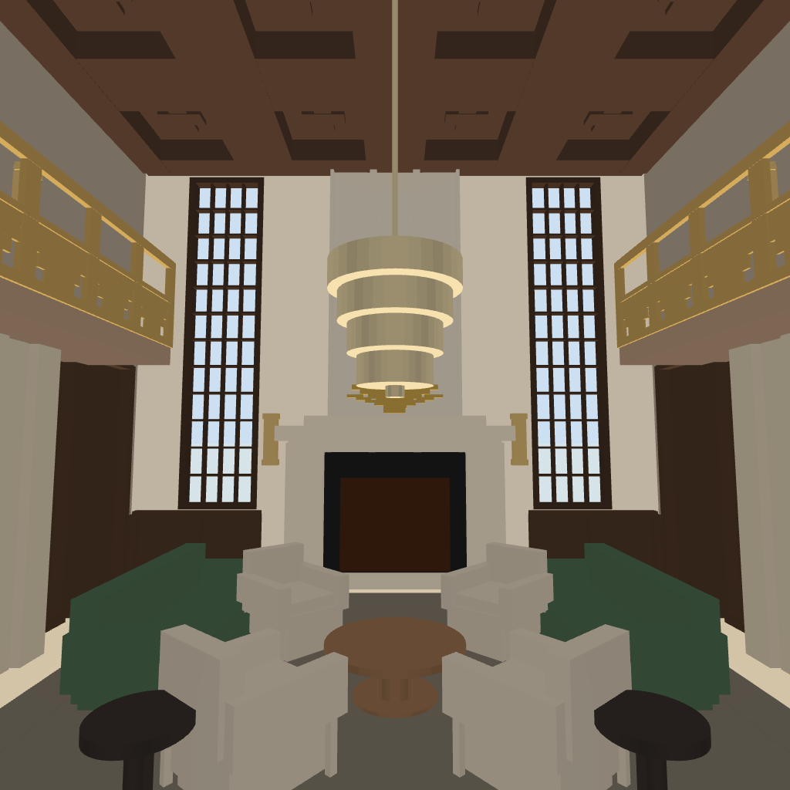
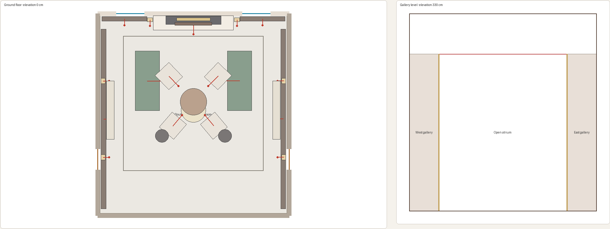
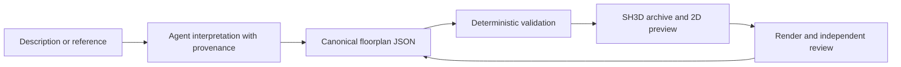

# Floorplan Agent Skill

A reusable agent workflow that turns a room description, measurements or visual reference into canonical JSON, a validated floor plan, and an editable Sweet Home 3D project.




## What makes this an AI project

The agent handles interpretation and explicit assumptions. Deterministic Python handles schema rules, geometric checks, previews and export. This separates plausible-looking model output from a document that actually meets the declared contract. The JSON remains the source of truth; the workflow regenerates exports after revisions.



## Try it

Python 3.10+. Core validation and SH3D export use the standard library; PNG previews additionally need Pillow. Sweet Home 3D is a separate application for opening and rendering `.sh3d` files.

```sh
python skills/create-sh3d-floorplans/scripts/floorplan_tool.py validate skills/create-sh3d-floorplans/references/templates/single-room.json
python skills/create-sh3d-floorplans/scripts/floorplan_tool.py build skills/create-sh3d-floorplans/references/templates/single-room.json --output sample.sh3d --svg sample.svg
python skills/create-sh3d-floorplans/scripts/floorplan_tool.py inspect sample.sh3d
```

For agent use, start with [SKILL.md](skills/create-sh3d-floorplans/SKILL.md). The bundled template, schema guide, camera fitting and reference-matching instructions give the agent a concrete contract instead of an open-ended drawing prompt.

## Design decisions

- Record whether a dimension is measured, specified or inferred, with confidence and a note.
- Build and review the shell, camera and lighting before furniture details.
- Model walls, openings, multiple levels and objects in an inspectable format.
- Generate the XML and model assets inside the SH3D archive from source.
- Use bounded render/review cycles; stop when the exporter cannot express the requested visual detail.

Three inferred example rooms and their author-generated renders are included. Original reference photographs are excluded; the renders show the current implementation and should not be read as a verified similarity score.

## Validation and limits

```sh
python -m unittest discover -s skills/create-sh3d-floorplans/scripts -p test_floorplan_tool.py
```

All 26 existing tests pass. They cover the schema, representative geometry, archive generation and inspection. The example JSON files are also validated separately. This is a design and research tool: dimensions inferred from a photograph remain uncertain, and neither structural suitability nor building-code compliance is established by a passing validator. [Publication review](PUBLICATION_REVIEW.md).
