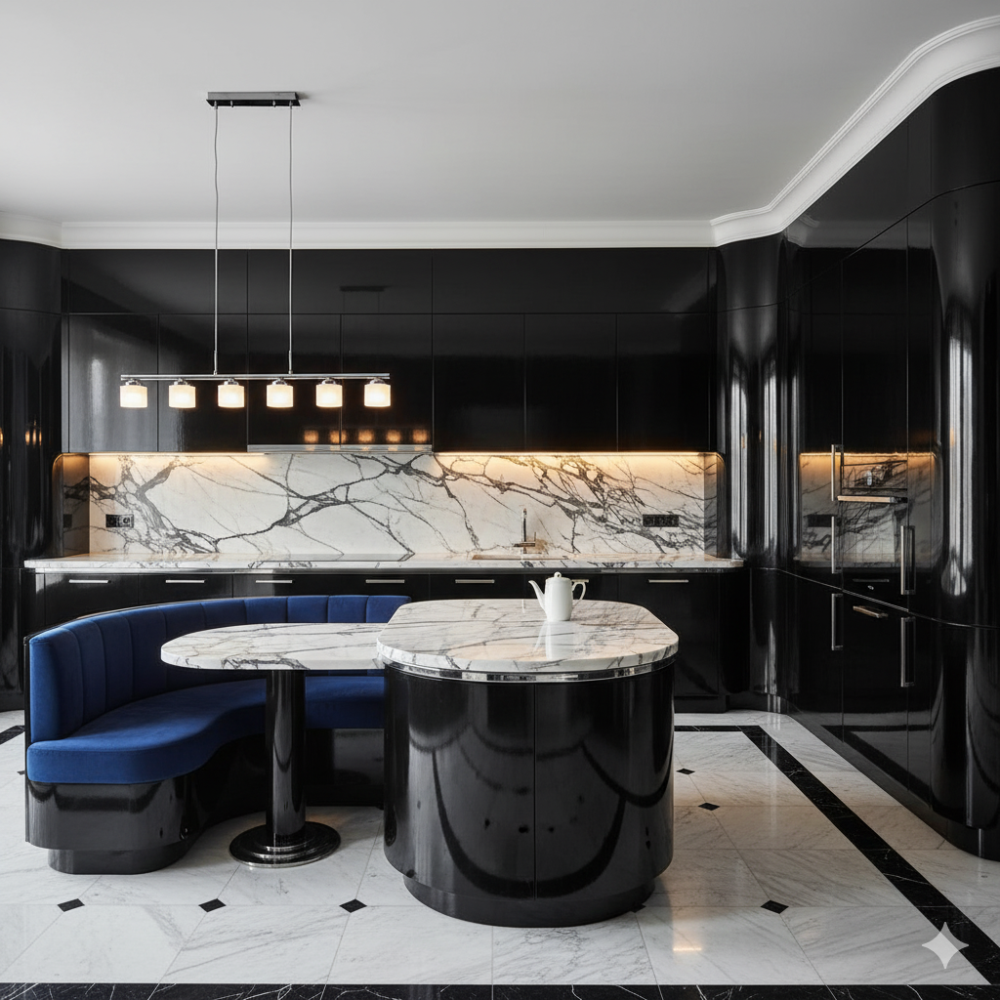
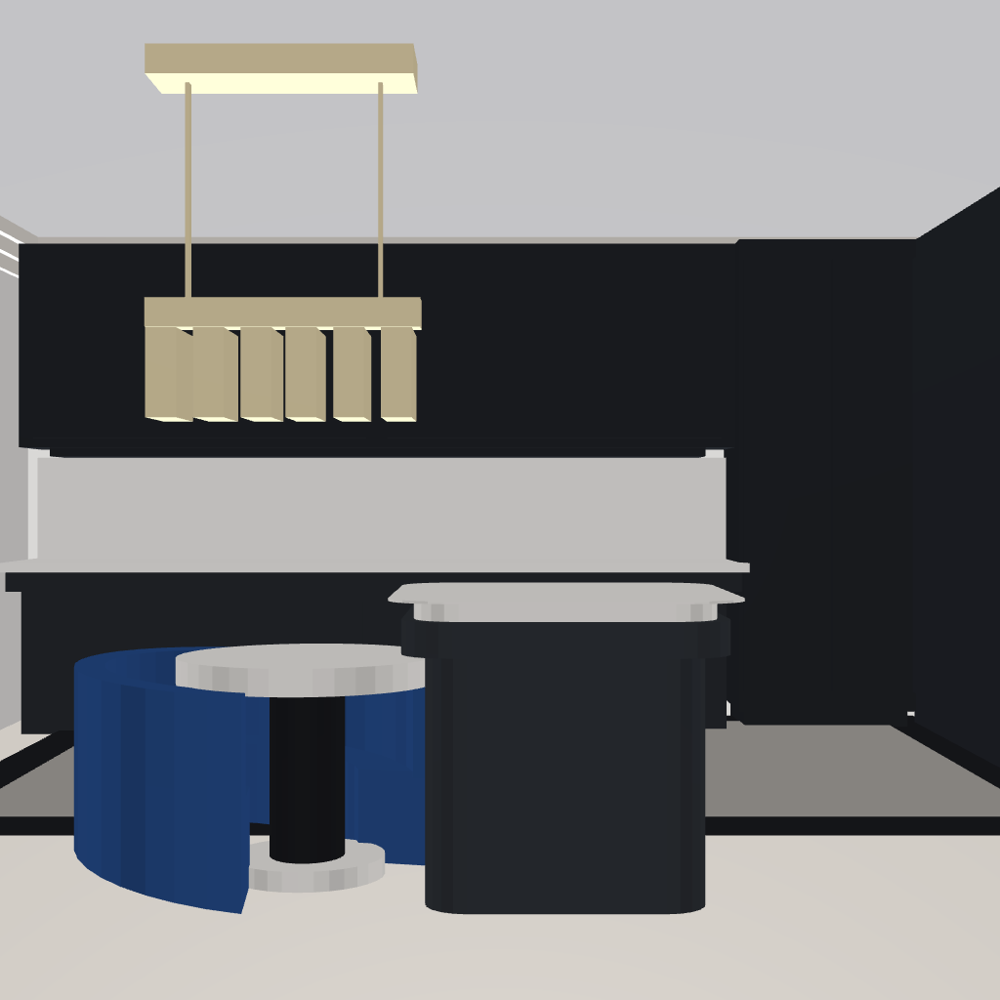
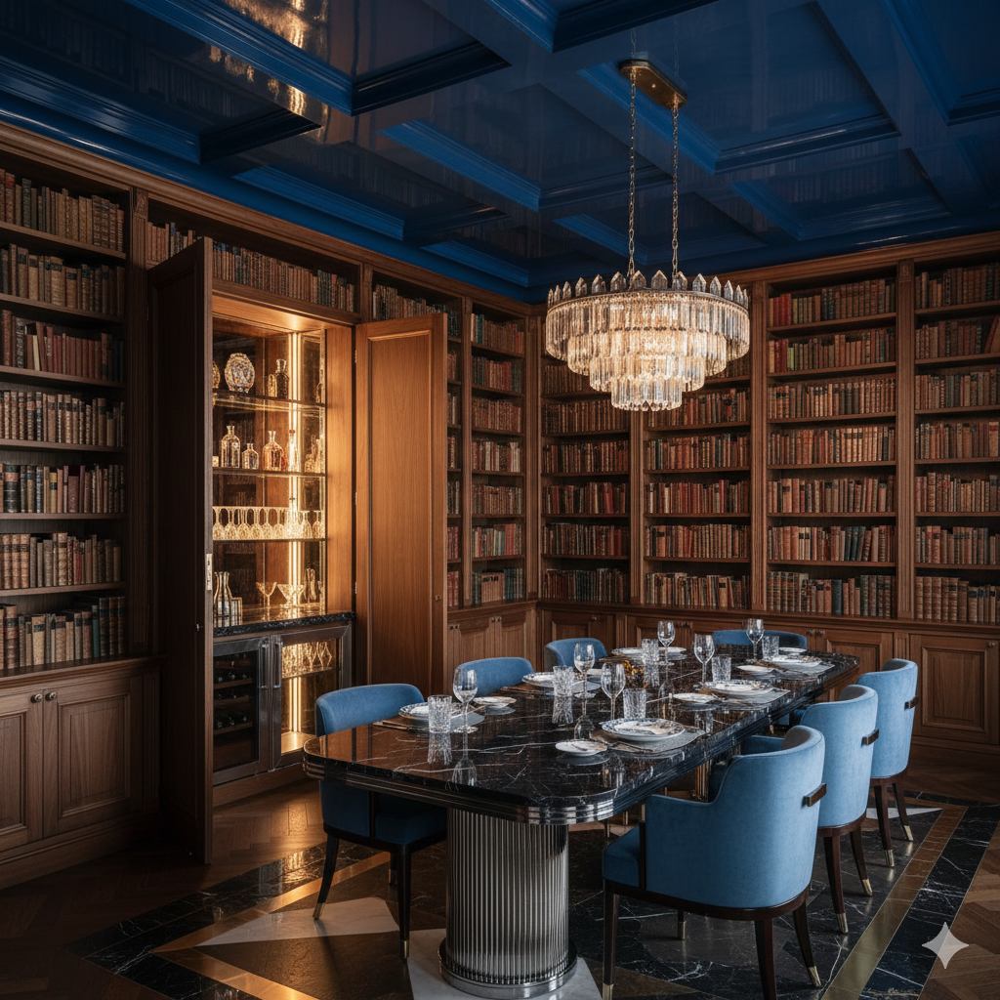
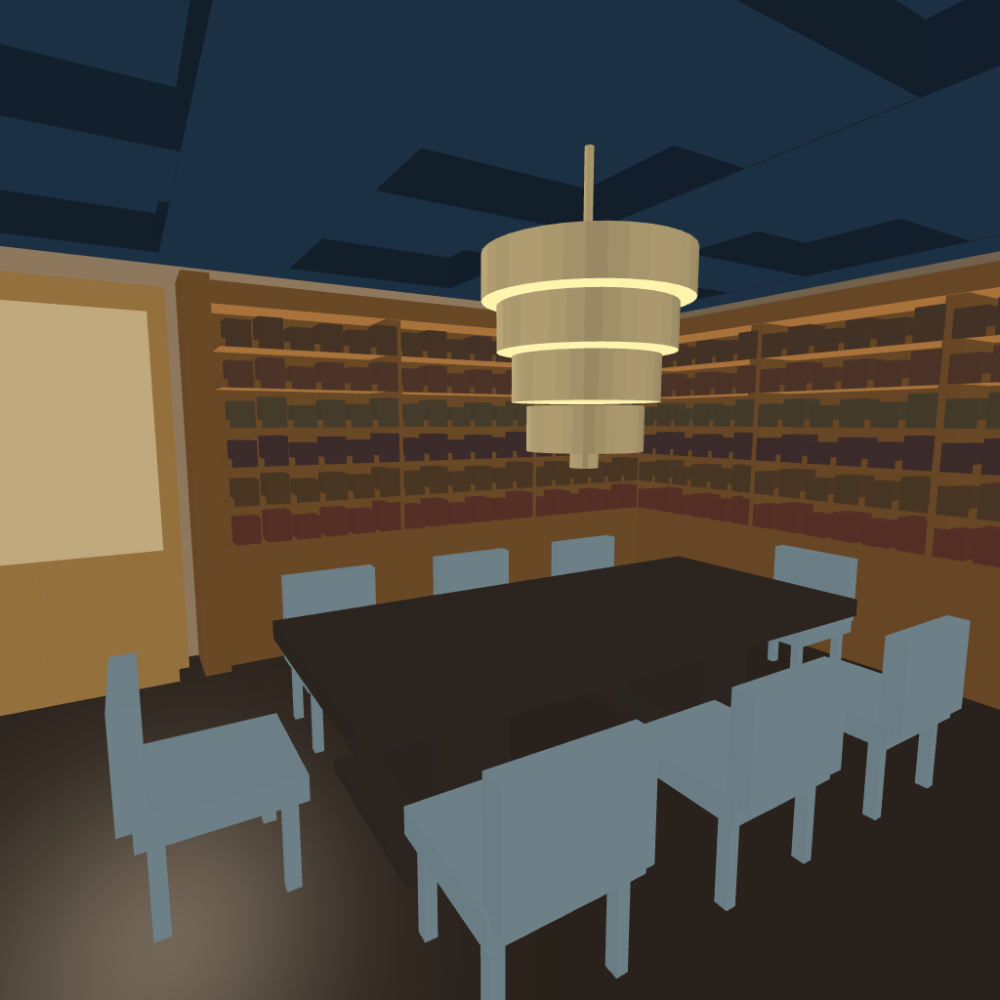
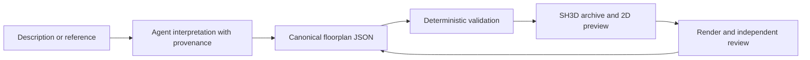

# Floorplan Agent Skill

**An agent skill for turning a room idea into a plan I can inspect, revise and open in a real design application.**

An attractive generated room image leaves practical questions unanswered: how large is the room, which dimensions were guessed, and how would I change the layout? I wanted an AI workflow that produces an editable design document alongside the picture.

The agent interprets a description, measurements or visual reference and records walls, openings, objects and assumptions in structured JSON. Python checks that plan, generates a preview and exports an editable **Sweet Home 3D** project. The public page explores three examples; the complete validator and exporter run locally.

## Public demo

[Open the live demo](https://kobin-ai-portfolio.kobinkempe.chatgpt.site/floorplan-agent-skill/) · [Read the case study](https://kobin-ai-portfolio.kobinkempe.chatgpt.site/case-studies/floorplan-agent-skill/)

## From a reference image to an editable room

These are historical skill-assisted examples from **25 July 2026**. The final authoring and review iterations used **Claude Opus 5**; earlier iterations used **Claude Opus 4.8**. The reference pictures are Gemini-generated room concepts supplied by me. The results were rendered from exported SH3D geometry in the **Sweet Home 3D JavaScript Viewer**. The result pictures are renders of editable models, rather than newly generated images.

| Example | Reference concept | Rendered reconstruction |
| --- | --- | --- |
| Double-height living room |  |  |
| Black marble kitchen |  |  |
| Library dining room |  |  |

Open any image at full size, or compare the reference, plan and render in the live demo. [Machine-readable provenance](demo/example-provenance.json) records model IDs, dates and image hashes. These examples do not compare newer models with an unassisted baseline or establish that a skill is still necessary for the task.

## What makes this an AI project

The agent handles interpretation and explicit assumptions. Deterministic Python handles schema rules, geometric checks, previews and export. This separates plausible-looking model output from a document that actually meets the declared contract. The JSON remains the source of truth; the workflow regenerates exports after revisions.



## Try it

Python 3.10+. Core validation and SH3D export use the standard library; PNG previews additionally need Pillow. Sweet Home 3D is a separate application for opening and rendering `.sh3d` files.

```sh
python skills/create-sh3d-floorplans/scripts/floorplan_tool.py validate skills/create-sh3d-floorplans/references/templates/single-room.json
python skills/create-sh3d-floorplans/scripts/floorplan_tool.py build skills/create-sh3d-floorplans/references/templates/single-room.json --output sample.sh3d --svg sample.svg
python skills/create-sh3d-floorplans/scripts/floorplan_tool.py inspect sample.sh3d
```

For agent use, start with [SKILL.md](skills/create-sh3d-floorplans/SKILL.md). The bundled template, schema guide, camera fitting and reference-matching instructions give the agent a concrete contract instead of an open-ended drawing prompt. Commands in that skill assume the working directory is `skills/create-sh3d-floorplans/`; the commands above run from the repository root.

## Design decisions

- Record whether a dimension is measured, specified or inferred, with confidence and a note.
- Build and review the shell, camera and lighting before furniture details.
- Model walls, openings, multiple levels and objects in an inspectable format.
- Generate the XML and model assets inside the SH3D archive from source.
- Use bounded render/review cycles; stop when the exporter cannot express the requested visual detail.

Three inferred example rooms, their reference concepts and generated outputs are included. Dimensions and unseen geometry are inferred; the renders should not be read as a verified similarity score.

## Validation and limits

```sh
python -m unittest discover -s skills/create-sh3d-floorplans/scripts -p test_floorplan_tool.py
```

The tests cover the schema, representative geometry, archive generation and inspection. Validate the example JSON files separately when changing them. This is a design and research tool: dimensions inferred from a picture remain uncertain, and neither structural suitability nor building-code compliance is established by a passing validator.

Sweet Home 3D and its viewer are separate dependencies; neither is bundled. See the [render and compare setup](skills/create-sh3d-floorplans/references/render-iteration.md) for the viewer download and local rendering workflow.

## Browser demo source

The standalone portfolio demo is in `demo/`. To try it locally, run:

```sh
python -m http.server 8000 --bind 127.0.0.1 --directory demo
```

Open http://127.0.0.1:8000.
